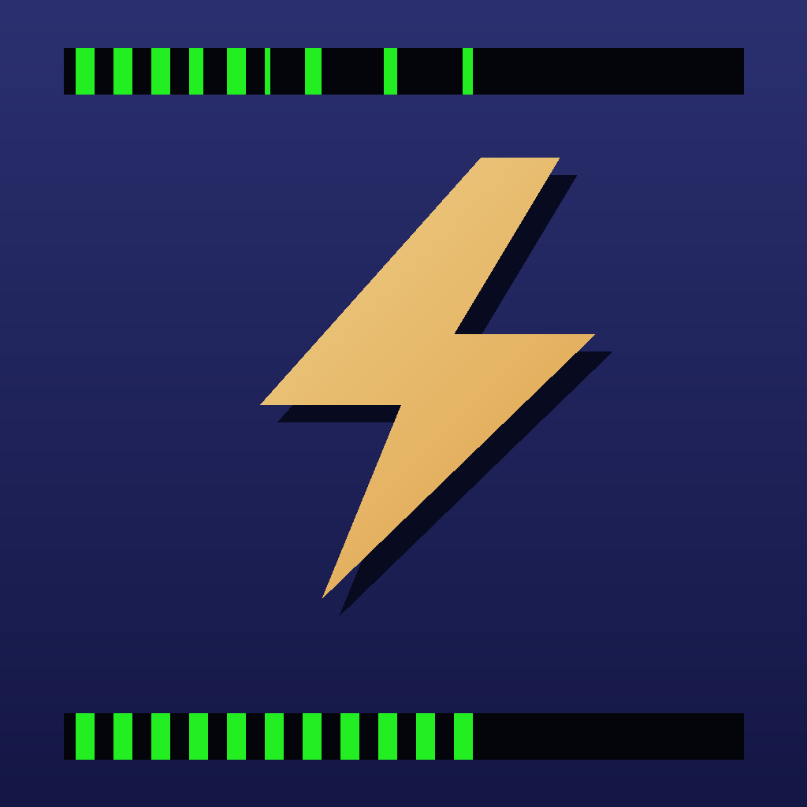
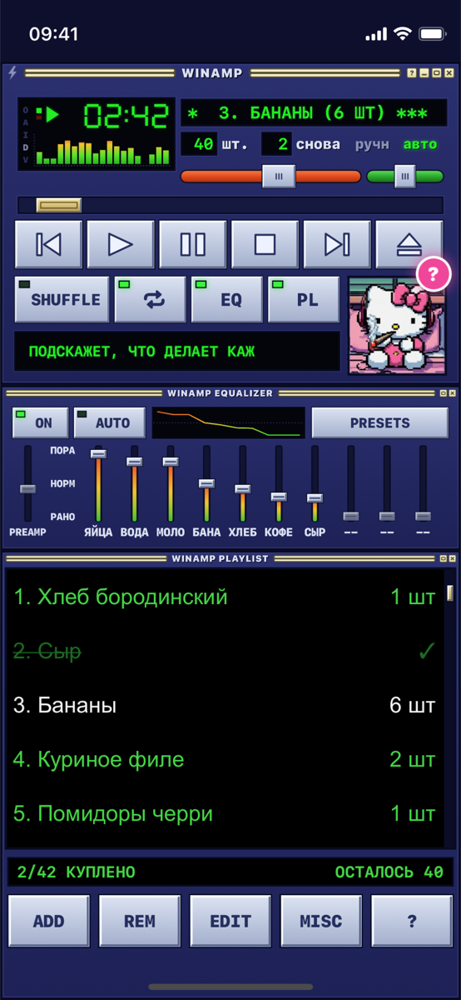
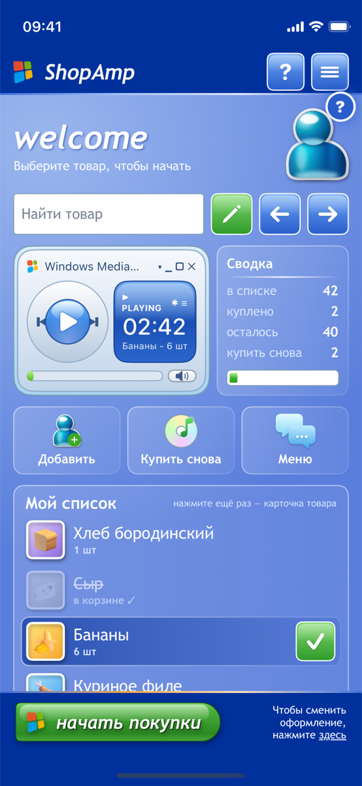
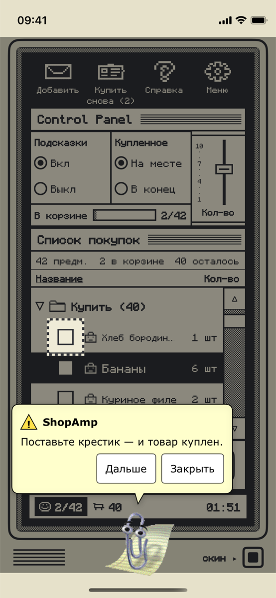
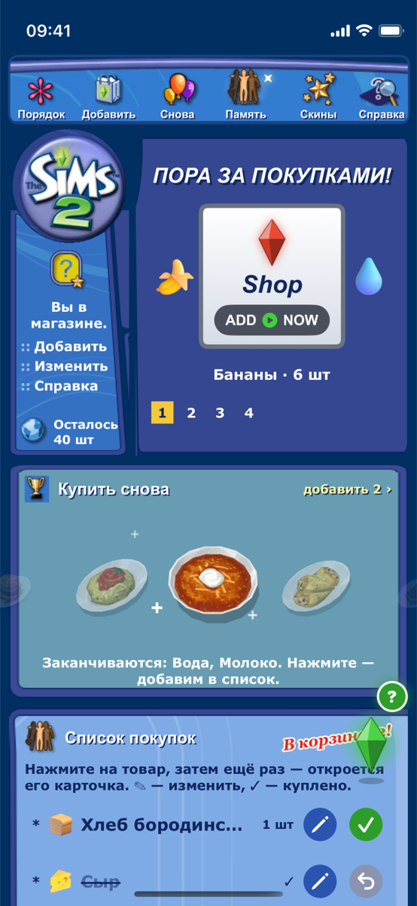
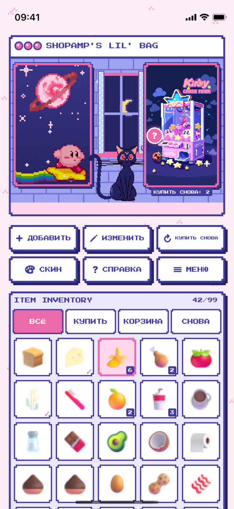

<p align="center">
  
</p>

<h1 align="center">ShopAmp</h1>

<p align="center">Список покупок для iPhone, который помнит, что вы покупаете регулярно,<br>в пяти ретро-скинах: Winamp, Windows XP / Frutiger Aero, Macintosh, The Sims 2 и Pixel Moon.</p>

<p align="center">
  <a href="docs/demo.mp4"><b>▶ Видео-демо (1 минута)</b></a> ·
  <a href="https://github.com/Geronimo1984/shopamp/releases/latest"><b>⬇ Скачать ShopAmp.ipa</b></a>
</p>

<p align="center">
  
  
  
  
  
</p>

## Что умеет

- **Карточки товаров** — постоянный каталог: базовые товары, готовый стартовый набор и всё, что вы заведёте сами. У карточки своя иконка (130+ на выбор) и срок «раз в N дней».
- **Список покупок** — только текущий поход в магазин. По умолчанию он сам наполняется тем, что **пора купить по срокам**; остальное отмечается ☑ в «Карточках». «Новый поход» — список заново по срокам, «Очистить список» — пустой список; карточки при этом не теряются. Купленное зачёркивается, а не удаляется.
- **Ориентировочная цена** — у карточки можно указать цену за штуку (в карточке или в окне товара, прямо по ценнику в магазине). В походе видно сумму корзины — что уже куплено — и примерную стоимость всего списка; у каждой позиции — «6 шт · 150 ₽».
- **Сроки** — приложение запоминает, когда вы покупали товар, считает средний интервал (или вы задаёте «раз в N дней» сами) и напоминает, когда пора купить снова.
- **5 скинов**, переключаются на лету, данные общие:
  - **Winamp** — плеер, эквалайзер и плейлист; ▶ — куплено, ■ — закончить; помощник — Hello Kitty.
  - **Frutiger Aero / Windows XP** — профиль с плеером WMP; режим покупок в стиле экрана приветствия XP со списком-барабаном (крутится свайпом вверх-вниз, вправо — в корзину); помощник — человечек MSN.
  - **Macintosh** — 1-битная Mac OS: Control Panel, Finder; помощник — Скрепыш.
  - **The Sims 2** — страница сайта thesims2.ea.com 2010 года, витрина блюд из игры; помощник — пламбоб.
  - **Pixel Moon** — пиксельный инвентарь, комната с Кирби, автоматом Kirby Crane Fever и кошкой Луной, которая подсказывает.
- **Помощник в каждом скине** — нажмите на персонажа: он расскажет про каждую кнопку и подсветит её.
- **Справка** в каждом скине, иконки товаров (130+ штук, выбираются вручную), пасхалки.

## Установка на iPhone (бесплатно, через AltStore)

Приложения нет в App Store. Его ставят как «приложение разработчика» с вашим бесплатным Apple ID через [AltStore](https://altstore.io). Понадобится Mac или ПК с Windows и кабель.

1. **Скачайте** `ShopAmp.ipa` из [последнего релиза](https://github.com/Geronimo1984/shopamp/releases/latest).
2. **Установите AltServer** на компьютер с [altstore.io](https://altstore.io).
   На Mac обязательно перенесите `AltServer.app` в папку «Программы» и запускайте оттуда, иначе он не видит телефон.
3. **Подключите iPhone кабелем**, разблокируйте и нажмите «Доверять этому компьютеру».
4. **Поставьте AltStore**: значок AltServer в строке меню → *Install AltStore* → ваш iPhone → войдите своим Apple ID.
5. На iPhone: **Настройки → Основные → VPN и управление устройством** → ваш Apple ID → «Доверять».
6. **Включите режим разработчика** (iOS 16+): *Настройки → Конфиденциальность и безопасность → Режим разработчика* → вкл → перезагрузка → «Включить».
7. **Установите ShopAmp**: зажмите **Option (⌥)** и нажмите на значок AltServer → *Sideload .ipa…* → iPhone → выберите `ShopAmp.ipa`.
   (Или перекиньте файл на iPhone через AirDrop и в AltStore: *My Apps → «+»*.)

> **Важно.** С бесплатным Apple ID приложение работает **7 дней**, потом его нужно продлить: AltStore → *My Apps* → *Refresh All* (компьютер с AltServer должен быть в той же Wi-Fi-сети). Список при продлении сохраняется. Одновременно можно держать не больше 3 таких приложений.

**Обновление:** скачайте новый `ShopAmp.ipa` и поставьте тем же способом поверх — данные останутся.

## Сборка из исходников

Нужны macOS и Xcode 16+.

```bash
git clone https://github.com/Geronimo1984/shopamp.git
cd shopamp
open ShopAmp.xcodeproj
```

Запуск в симуляторе — ▶ в Xcode. Неподписанный `.ipa` для AltStore:

```bash
xcodebuild -project ShopAmp.xcodeproj -scheme ShopAmp -configuration Release \
  -sdk iphoneos -destination 'generic/platform=iOS' -derivedDataPath build \
  CODE_SIGNING_ALLOWED=NO
mkdir -p Payload && cp -R build/Build/Products/Release-iphoneos/ShopAmp.app Payload/
zip -qry ShopAmp.ipa Payload
```

Флаги запуска для демонстрации: `-demo` (тестовый список), `-skin=winamp|aero|mac|sims|pixel`, `-shop`, `-assist -tip=N`.

## Устройство проекта

```
ShopAmp/
  Shared/        общие данные и логика: список, память покупок, иконки, помощники, окна
  Skins/Winamp   Skins/Aero   Skins/Mac   Skins/Sims   Skins/Pixel   — по папке на скин
  Assets.xcassets   графика скинов и иконки товаров
  Fonts/            пиксельные шрифты (OFL)
```

SwiftUI, iOS 16+, без сторонних зависимостей. Данные хранятся локально на телефоне (`Documents/shopamp.json`).

---

<p align="center"><sub>накодил geronimo</sub></p>
